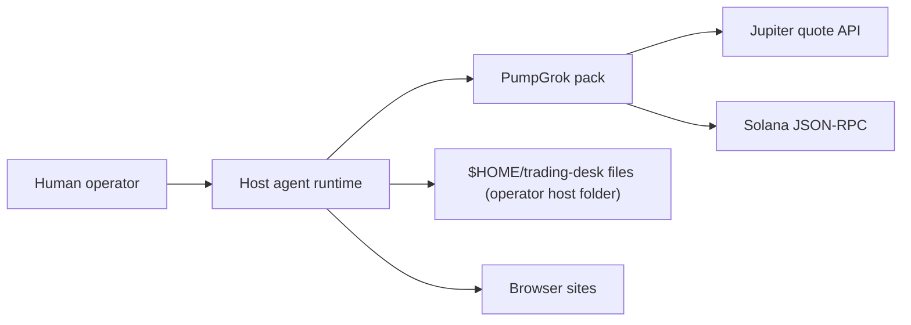
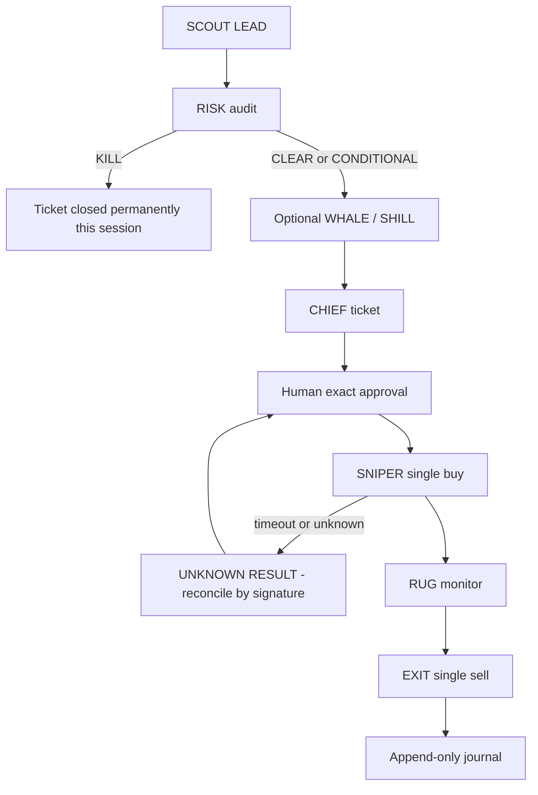

# PumpGrok architecture

Maintainer map of this repository. PumpGrok is an instruction pack plus small CLIs that never sign or send; they write only local files, mainly under `var/`. It is not a long-running application.

## Overview

PumpGrok turns a host agent runtime into a ten-seat Solana memecoin trading desk.

| Layer | What it is | What it is not |
|-------|------------|----------------|
| `agents/*.md` | Role profiles and standing instructions, including the Global Security Constitution | Executable workers |
| `skills/*/SKILL.md` | Named procedures the host loads by frontmatter `name` | A framework or SDK |
| `rules/pumpgrok-team.mdc` | Always-applied constitution (`alwaysApply: true`) | Runtime enforcement code |
| `src/pumpgrok/tools/*` | Fail-closed tool registry (JSON via guarded `pumpgrok` verbs) | Signers, senders, or wallets |
| Screening engine (`src/pumpgrok/engine/`) | Replay-only port of the vendored grokbot-pumpfun engine. `vendor/grokbot-pumpfun/` is absent from this checkout; formerly vendored (see `docs/VENDOR_PIN.md`) | Signers, senders, or wallets; no trade subscription |
| Plugin manifests | How Cursor / Claude Code / Grok Build / Grok Bot discover the pack | A deployable service |

This tree runs no always-on services behind the desk. The process that “runs” the desk is the host (Grok Bot, Cursor, Claude Code, or Grok Build). The one long-running form is `pumpgrok run --mode paper --serve --replay <dataset>`: it replays a recorded dataset in a loop while serving read-only `/healthz` and `/metrics` (paper-only; the compose `pumpgrok` service runs this form). Humans approve every spend by exact ticket ID. Only SNIPER may send buys; only EXIT may send sells.

## System context

External systems named in skills or tools:

| System | How PumpGrok uses it |
|--------|----------------------|
| Jupiter Swap API `https://api.jup.ag/swap/v2/order` (`QUOTE_URL`; never `/execute`) | Informational exec-side quote only; never swap/send |
| Solana bonding curve (on-chain reserves) | `market.price` spot read via `getAccountInfo` on the curve account (ASSUMED layout). Paper fills and marks read the curve through the paper adapter's `_read_curve` port and price with `execution/curve_math.py` |
| Solana JSON-RPC (default `https://api.mainnet-beta.solana.com`) | `onchain.authorities` (`getAccountInfo`), `onchain.priority_fee` (`getRecentPrioritizationFees`), `onchain.top_holders` (`getTokenLargestAccounts`) |
| `PUMPGROK_RPC__ENDPOINTS` | Same RPC methods; SETUP.md mentions a private RPC (Helius, QuickNode, etc.) as an operator choice |
| Browser sites (tool-connections / discovery) | X / Twitter, pump.fun, gmgn.ai, jupiter.ag, Photon / Axiom, solscan.io, rugcheck.xyz — opened by the human/host browser, not by these Python tools |
| x.ai Grok API, pump.fun frontend REST, PumpPortal WS | Endpoints are declared in `config/settings.py` (`ws_url`, x.ai `base_url`). Clients that remain in the package: the PumpPortal websocket consumer `LaunchMonitor.stream` (`src/pumpgrok/engine/monitor.py`) and the x.ai client `GrokAgent._call` (`src/pumpgrok/engine/agents/base.py`, used by the auditor, timing, narrative and checker agents). The replay CLI path calls neither; it imports only pure helpers from `engine/monitor.py`. The in-tree REST analyzer (`src/pumpgrok/engine/analyzer.py`) and the pump.fun read client (`src/pumpgrok/tools/social/client.py`) call pump.fun REST; the read client is not registered as a tool. The retired vendor engine made these calls (see `docs/VENDOR_PIN.md`) |

No server database, message bus, or secrets manager is referenced. Tools take no API keys. The paper ledger is one SQLite file, `var/ledger.sqlite`. There are no `os.environ` / `.env` readers in the instruction pack's own files; the retired vendor engine (absent from this checkout; see `docs/VENDOR_PIN.md`) kept its own `GROKBOT_*` environment contract outside PumpGrok and desk files.



## Containers or processes

Only one repo process ever runs as a service, and only on request: `pumpgrok run --mode paper --serve --replay <dataset>` replays a recorded dataset in a loop and serves read-only `/healthz` and `/metrics` (paper-only; the compose `pumpgrok` service runs this form). The one-shot `run --mode paper --once --replay <dataset>` form runs a single cycle and exits.

| Runtime | How it is started | Responsibility |
|---------|-------------------|----------------|
| Host agent | Operator opens the repo / installs the plugin | Loads agents, skills, and rules; talks on the Trading Floor; may invoke tools |
| `pumpgrok <verb>` | One-shot CLI from the repo root (`uv run pumpgrok ...`) | Structured reads / paper journal appends |
| `./scripts/check.sh` | One-shot from the repo root | Offline lint of instruction files |
| Screening engine dry-run (retired vendor process) | `skills/grokbot-pipeline` describes the procedure; the vendor process is absent from this checkout (see `docs/VENDOR_PIN.md`) | Screening evidence only; signs nothing, sends nothing |
| Human wallet (throwaway, outside this repo) | Screen hand-off only (`tool-connections`) | Actual signing; never handled by PumpGrok files |

`rules/pumpgrok-team.mdc`: if the host has no persistent Bots or group chats, use subagents or role-labelled passes and state which fallback is active. Do not invent a Bot-creation API.

## Module map

Dependency direction observed in the tree: **rules constrain agents; agents name skills; skills prefer tools; tools talk to public HTTP/RPC; none of those layers import each other as code.**

```
plugin manifests  -->  agents/  skills/  rules/
rules/pumpgrok-team.mdc  -->  agents/*  (roles + hard constraints)
agents/*.md  -->  skills/*  (frontmatter skills: lists)
skills/*  -->  `pumpgrok` verbs  (documented CLI, not Python imports)
tool registry  -->  Jupiter / Solana RPC / ledger files
`pumpgrok scout pipeline`  -->  not implemented (exit 5); no vendor import
scripts/check.sh  -->  agents/, skills/, rules/  (read-only validation)
```

**Retired vendor components.** The grokbot-pumpfun engine was vendored under `vendor/grokbot-pumpfun/`. That directory is absent from this checkout; formerly vendored (see `docs/VENDOR_PIN.md`, pin `409e74c905faa0e9de42e918efe2c604f206856e`). Its screening logic is ported in-tree as the `src/pumpgrok/engine/` package, a port of the retired oracle. The `pumpgrok scout pipeline --candidates` verb is registered but not implemented: it exits 5 with `status: not-yet-implemented`. Pipeline verdicts are never RISK clearance or human approval. SNIPER and EXIT remain the only exchange writers.

### Agents (`agents/`)

| File | Role | `writes_to_exchange` | Skills listed in frontmatter |
|------|------|----------------------|------------------------------|
| `chief.md` | Desk orchestrator; never trades | false | desk-operating-model, desk-trade-lifecycle, desk-risk-limits, desk-monitoring, desk-post-trade-review, desk-incident-response, pumpgrok-setup, tool-connections, grokbot-pipeline |
| `scout.md` | Discovery / LEAD schema | false | discovery-tools, grokbot-pipeline, solana-market-data, social-sentiment, desk-trade-lifecycle |
| `risk.md` | Absolute safety gate; CLEAR / CONDITIONAL / KILL | false | risk-audit, desk-risk-limits, grokbot-pipeline, solana-market-data, solana-rpc-and-wallet |
| `whale.md` | Holder / smart-money context after RISK | false | holder-and-flow-analysis, solana-market-data, discovery-tools, grokbot-pipeline |
| `sniper.md` | Only buy sender | true | jupiter-routing, desk-execution-protocol, solana-rpc-and-wallet, solana-api-reference, solana-market-data, grokbot-pipeline |
| `rug.md` | Post-fill red-flag monitor; never closes | false | position-monitoring, desk-monitoring, solana-market-data, grokbot-pipeline |
| `exit.md` | Only sell sender | true | position-monitoring, desk-execution-protocol, desk-post-trade-review, jupiter-routing, grokbot-pipeline |
| `shill.md` | Social velocity / quality | false | social-sentiment, discovery-tools, grokbot-pipeline |
| `signal.md` | Momentum scorer; its score is evidence, never clearance | false | grokbot-pipeline, solana-market-data, momentum-signals, replay-and-backtest, verification-receipts, desk-doctor |
| `journal.md` | Post-trade ledger; reports and reviews, never trades | false | desk-post-trade-review, desk-folders-and-journal, hermes-cron-desk, portfolio-ledger, daily-report, verification-receipts |

SETUP.md Trading Floor group: CHIEF, SCOUT, RISK, WHALE, SNIPER, RUG. EXIT, SHILL, SIGNAL and JOURNAL are DM seats (`seat: DM` in their frontmatter).

### Skills (`skills/`)

Each directory has one `SKILL.md` whose frontmatter `name` must match the directory (`scripts/check.sh` enforces this).

| Group | Skills |
|-------|--------|
| Bootstrap | pumpgrok-setup, tool-connections, desk-operating-model, desk-folders-and-journal |
| Process and risk | desk-trade-lifecycle, desk-risk-limits, desk-execution-protocol, risk-audit, desk-monitoring, desk-post-trade-review, desk-incident-response, desk-strategy-lab |
| Domain | discovery-tools, jupiter-routing, position-monitoring, holder-and-flow-analysis, social-sentiment, solana-market-data, solana-api-reference, solana-rpc-and-wallet, browser-ops |

`desk-operating-model` is the constitution. `desk-trade-lifecycle` is the ticket procedure. `risk-audit` and `jupiter-routing` are the critical domain skills (`rules/pumpgrok-team.mdc`).

### Tools (`src/pumpgrok/tools/`)

All tools: registry-resolved, JSON on stdout, fail closed (`ok: false` + error), no private keys, no signing, no sends. Operator verbs call them through guarded seats; `pumpgrok tools <id> --help` prints one input schema.

| Tool id | Outbound call or write | Port module |
|--------|------------------------|------|
| `market.price` | RPC `getAccountInfo` on the bonding-curve account (ASSUMED layout); no Jupiter path in this module | `tools/market/price.py` |
| `onchain.authorities` | RPC `getAccountInfo` jsonParsed | `tools/onchain/authorities.py` |
| `onchain.priority_fee` | RPC `getRecentPrioritizationFees` | `tools/onchain/priority_fee.py` |
| `onchain.top_holders` | RPC `getTokenLargestAccounts` | `tools/onchain/top_holders.py` |
| `journal.append` | Append ledger rows | `tools/journal/append.py` |
| `exec.simulate` / `exec.place` | Paper fills only | `tools/exec/simulate.py`, `tools/exec/place.py` |
| `pumpgrok scout pipeline --candidates` | Not implemented: exits 5 with `status: not-yet-implemented` | None |

### Plugin manifests

| File | Host |
|------|------|
| `plugin.json` | agent-plugins.org schema; Grok Bot |
| `.claude-plugin/plugin.json` + `marketplace.json` | Claude Code |
| `.cursor-plugin/plugin.json` | Cursor (`skills`, `agents`, `rules` paths) |
| `.grok-plugin/plugin.json` + `marketplace.json` | Grok Build |

## Data and control flow

Ticket ID format: `SOL-YYYYMMDD-NNN`.

Stages in `skills/desk-trade-lifecycle/SKILL.md` (strict order):

1. Lead (SCOUT) — LEAD block with mint + source + UTC
2. Audit (RISK) — fail-closed 10-check list; verdict CLEAR, CONDITIONAL, or KILL
3. Context (optional WHALE + SHILL)
4. Ticket creation (CHIEF) — `pumpgrok ticket next|create|list`
5. Human approval — message must contain ticket ID + mint + size + max slippage; analysis is not approval
6. Single buy (SNIPER) — Jupiter quote + priority fee; send once
7. Monitor (RUG) — alerts only
8. Exit (EXIT) — sells only, same single-send rule
9. Journal (CHIEF + EXIT)



Retry behavior that **is** implemented as policy (instructions, not code): on unknown, timeout, or failed send, SNIPER/EXIT must not auto-retry; they report `UNKNOWN RESULT – reconcile by signature` and wait for a fresh human approval.

Tool-level errors: HTTP/RPC exceptions become `{"ok": false, "error": ...}` JSON and the process exits 1. Ticket IDs are allocated by `pumpgrok ticket next` (`src/pumpgrok/ledger/tickets.py`), with a bounded retry on UNIQUE collisions (`MAX_ATTEMPTS`).

Engagement levels (`desk-operating-model`): **research** (no money), **paper** (`pumpgrok run --mode paper --once --replay <dir>` writes its ledger to `var/replay/<dataset>/ledger.sqlite`; the operator paper ledger is `var/ledger.sqlite`; `pumpgrok paper buy|sell` refuses with code `unavailable` until the Phase 4 curve reader is verified, see `src/pumpgrok/cli/codes.py`). There is no higher level on this desk. Daily loss >= 5% of wallet equity -> CHIEF posts `FLOOR HALTED - DAILY LOSS LIMIT` and refuses new entries until the human resets.

## Persistence

No server database, migrations, or cache layer. The operator paper ledger is one SQLite file (`var/ledger.sqlite`, `src/pumpgrok/ledger/store.py`); each recorded-data replay run keeps its own ledger at `var/replay/<dataset>/ledger.sqlite` (`src/pumpgrok/supervisor/scheduler/replay_runtime.py`). Desk operational files live under `var/desk/` (`src/pumpgrok/ledger/paths.py`).

Desk files live **outside** the git tree, conventionally:

```
$HOME/trading-desk/
  proposals/     operator folder; ticket IDs come from `pumpgrok ticket next`
  briefs/
  leads/
  research/
  journal/       operator folder; the ledger of record is var/ledger.sqlite
  incidents/
  positions/
  watch/
  risk-limits.md
  desk.md        engagement, public wallet address, daily loss limit
```

Journal rules (`desk-folders-and-journal`): append-only; every entry needs ticket ID and UTC. Ticket IDs come from `pumpgrok ticket next|create|list` (`src/pumpgrok/ledger/tickets.py`). `scripts/hermes-bootstrap.sh` defaults the desk folder to `${HOME}/trading-desk` (`PUMPGROK_DESK` overrides it) and creates the folders listed above.

This repository itself stores instruction files, plugin JSON, Python helpers, the in-tree screening engine `src/pumpgrok/engine/` (ported from the retired vendor tree, see `docs/VENDOR_PIN.md`), `SETUP.md`, and `banner.jpg`.

## Configuration and secrets

| Mechanism | Where |
|-----------|--------|
| `PUMPGROK_RPC__ENDPOINTS` | `tools/onchain/authorities.py`, `tools/onchain/priority_fee.py`, `tools/onchain/top_holders.py` (`RpcSettings` in `config/settings.py`) |
| `PUMPGROK_DESK` | `scripts/hermes-bootstrap.sh`, `scripts/hermes-install-cron.sh`, `scripts/hermes-verify-isolation.sh` (default `${HOME}/trading-desk`; their `--desk` flag overrides it) |
| Quote params | `src/pumpgrok/tools/market/jupiter.py` (`QUOTE_URL`) |
| Desk record | `$HOME/trading-desk/desk.md` (engagement, public address, RPC note) |
| Risk numbers | `$HOME/trading-desk/risk-limits.md` from the RISK/CHIEF interview |
| `GROKBOT_*` environment variables | None read by this tree; the retired vendor engine used them (see `docs/VENDOR_PIN.md`); never stored in PumpGrok or desk files |

Do not put seed phrases, private keys, or live RPC credentials in git. Connection is screen hand-off; only the public address is recorded. Tools do not read environment variables.

## Cross-cutting

**Auth / keys.** Global Security Constitution in every agent file and in `desk-operating-model`: never request, accept, store, print, or reason about seed phrases or private keys. Throwaway wallet ≤ $200 USDC + SOL for fees.

**Approval.** Human message with exact ticket ID + mint + size + max slippage after the ticket was shown. Earlier messages are not consent.

**Write boundary.** `scripts/check.sh` expects only `sniper` and `exit` to set `writes_to_exchange: true` (soft check).

**Observability.** Instruction-level: UTC-timestamped sourced evidence, ticket IDs in the journal, CHIEF desk status. `run --serve` serves read-only `/healthz` and `/metrics` on 127.0.0.1 (`src/pumpgrok/doctor.py`, `src/pumpgrok/cli/verbs_state.py`). No tracing code.

**Feature flags.** None. Engagement level in `desk.md` is the mode switch.

**Validation.** `scripts/check.sh`: YAML frontmatter on agents and skills, skill `name` matches directory, constitution phrase spot-check, `rules/pumpgrok-team.mdc` exists, Hermes helper scripts executable, no emoji in markdown / `.mdc`. Stdlib Python only; no network. `uv run pytest tests/test_tools_cli.py` covers tool CLI contracts.

## Change guidance

| Change | Typical landing | Do not couple |
|--------|-----------------|---------------|
| New role constraint | `rules/pumpgrok-team.mdc` + matching standing instructions in every `agents/*.md` | Do not encode veto/approval in Python |
| New procedure | `skills/<name>/SKILL.md` with matching `name`, then add it to the relevant agent `skills:` list | Do not put strategy or return claims in skills (`rules` forbid it) |
| New structured read | Registry tool under `src/pumpgrok/tools/*`, fail closed, no signing | Do not add send/swap/sign paths |
| Host packaging | The matching `plugin.json` / marketplace file | Do not invent a Bot-creation API |
| Bootstrap steps | `SETUP.md` and `skills/pumpgrok-setup/SKILL.md` | Keep engagement at research in setup |
| Lint rules | `scripts/check.sh` | Keep it offline |

Keep the tool registry read/prepare-only. Keep RISK KILL non-overridable. Keep SNIPER/EXIT as the only exchange writers.

## Unknowns

- Plugin manifests `plugin.json` and `pyproject.toml` carry `"license": "AGPL-3.0"` (plugin.json) and `https://github.com/swcstudiospace/PumpGrok` URLs, matching the root [LICENSE](LICENSE) (GNU Affero General Public License v3.0 for Spectrum Web Co LLC / swcstudiospace). The two marketplace manifests and `SETUP.md` still carry a placeholder organisation name, which `scripts/check.sh` allowlists until the real organisation is supplied.
- `jupiter-routing` shows `priority_fee` percentile/multiplier inputs (default multiplier 1.2); the retired fee-cap flag is removed.
- Whether a given host actually creates ten seats and a Trading Floor group depends on that host. This repo only supplies files and SETUP.md instructions.
